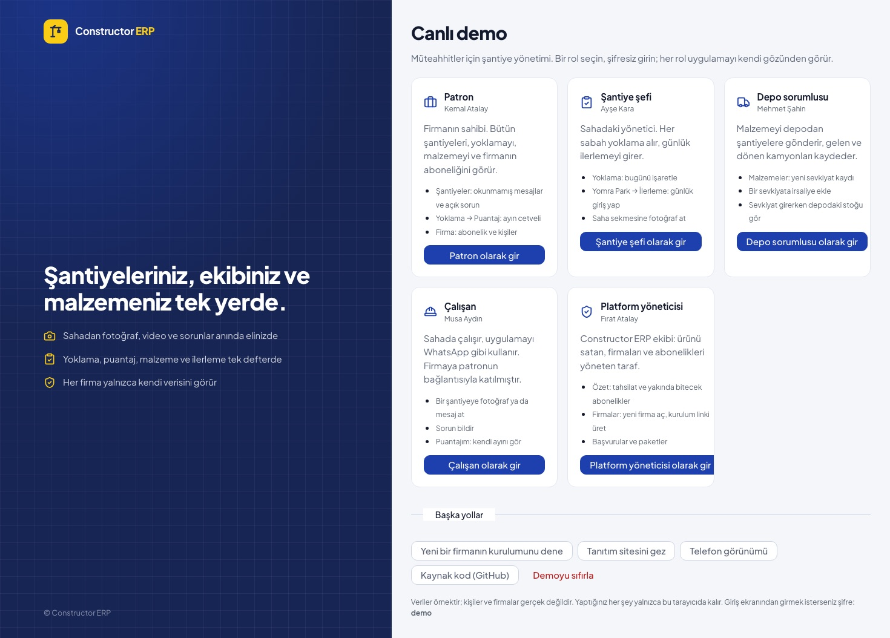
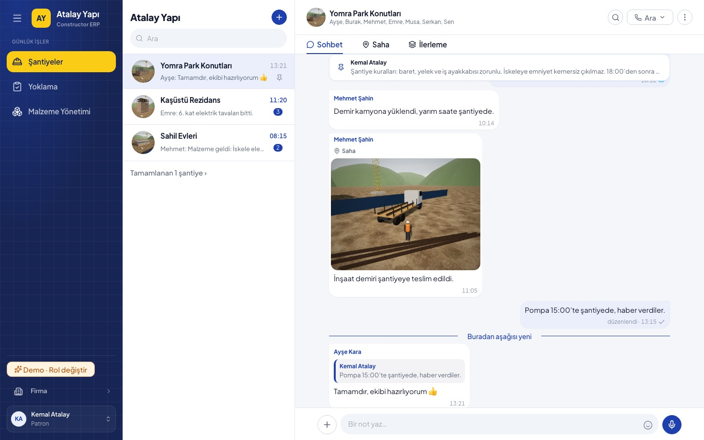
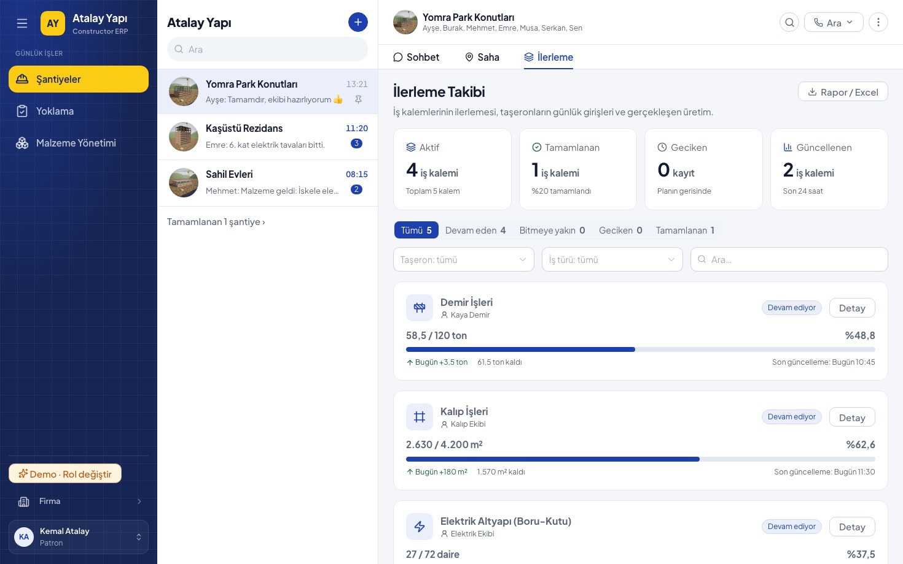
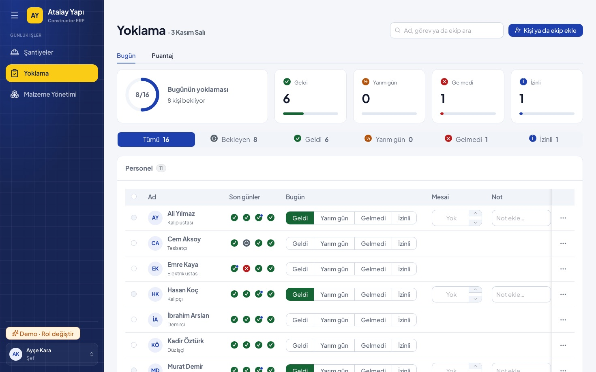
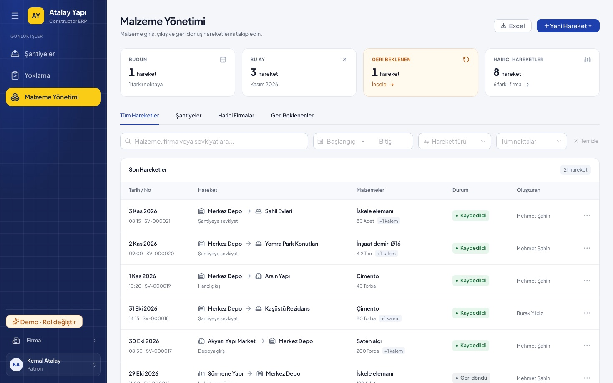
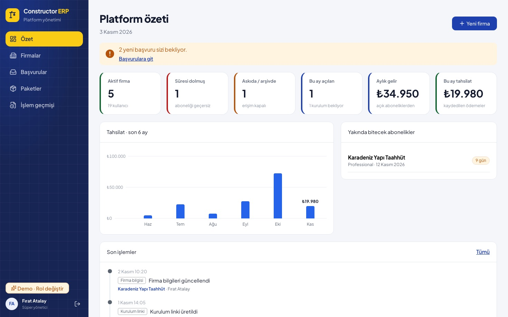
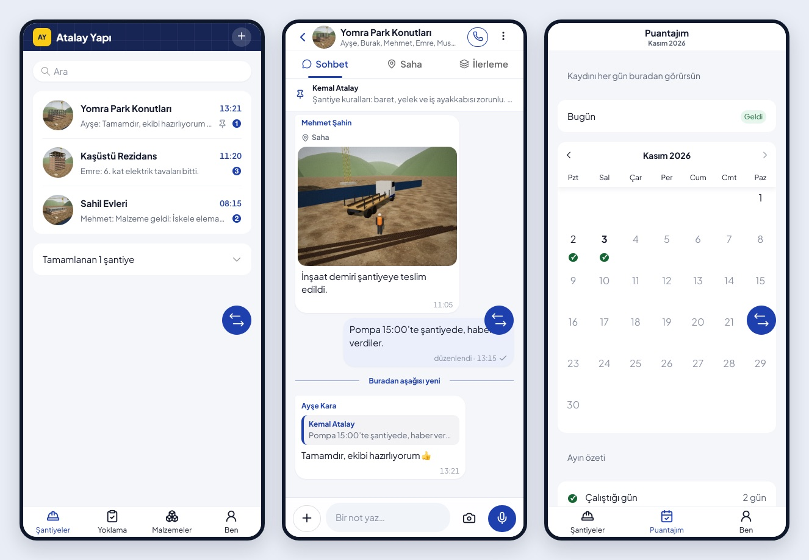
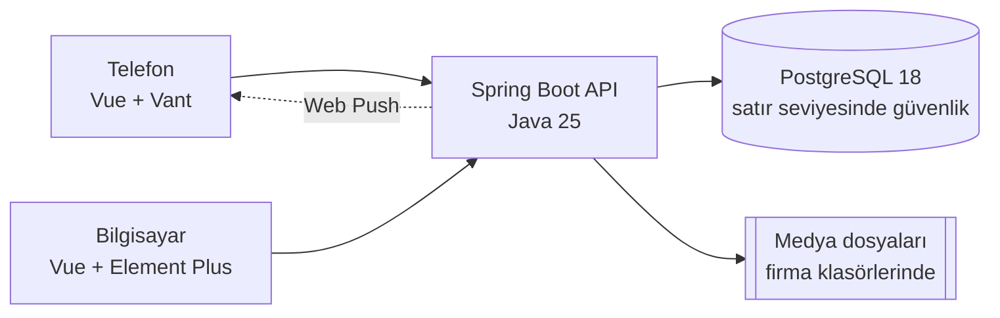

# Constructor ERP

Müteahhitlerin şantiyelerini WhatsApp grupları yerine tek yerden yönettiği, çok firmalı (multi-tenant) SaaS ERP.
Telefonda sade bir saha arayüzü, bilgisayarda yönetim paneli. İlk müşterisi Kızılkan İnşaat'tır.

**[Canlı demo nasıl çalışır](docs/09-yayina-alma.md#çözüm-tarayıcıda-çalışan-canlı-demo)** · [Dokümanlar](docs/README.md) · [Mimari](docs/02-mimari.md) ·
[Ürün kararları](docs/08-urun-kararlari.md) · [Sorular ve cevaplar](docs/10-sorular.md)



## Canlı demo

Demo backend'siz, tarayıcının içinde çalışır: bekleme yok, kurulum yok. Bir rol seçip şifresiz girersiniz.

| Rol | Kim | Ne görürsünüz |
|---|---|---|
| Patron | Kemal Atalay | Bütün şantiyeler, okunmamış mesajlar ve açık sorunlar, puantaj, malzeme, firma ve abonelik |
| Şantiye şefi | Ayşe Kara | Bugünün yoklaması, taşeron ilerlemesi, şantiyenin Saha akışı |
| Depo sorumlusu | Mehmet Şahin | Sevkiyat defteri, irsaliyeler, sevkiyat girerken depodaki stok |
| Çalışan | Musa Aydın | WhatsApp gibi şantiye sohbeti, sorun bildirme, kendi puantajı |
| Platform yöneticisi | Fırat Atalay | Firmalar, paketler, abonelik ve ödemeler, kurulum linkleri, başvurular, işlem geçmişi |

Uygulamanın içindeki **Demo** düğmesiyle rol değiştirilir, telefon ve bilgisayar görünümü arasında geçilir, demo
sıfırlanır. Satın alan bir firmanın kurulum sihirbazı da denenebilir. Veriler örnektir, kişiler ve firmalar gerçek
değildir. Demonun nasıl çalıştığını [09 · Yayına alma](docs/09-yayina-alma.md)'da anlattım.

## Ekranlar

| | |
|---|---|
|  |  |
| **Şantiye bir sohbet grubu:** fotoğraflı Saha mesajı, sabitlenmiş kurallar, okunmamışlar | **İlerleme:** şef yalnızca "bugün ne kadar"ı yazar, gerisini sistem hesaplar |
|  |  |
| **Yoklama:** tek tıkla işaretleme, mesai ve not; ay sonunda puantaj ve Excel | **Malzeme:** sevkiyat defteri; nereden, nereye, ne kadar, irsaliyesiyle |
|  |  |
| **Platform yönetimi:** firmalar, tahsilat, yakında bitecek abonelikler | **Telefon arayüzü:** şantiye listesi, sohbet, çalışanın puantajı |

## Öne çıkan mühendislik kararları

- **Firmalar arası ayrım veritabanında da garanti.** Servisler firmaya göre süzüyor, PostgreSQL de satır seviyesinde
  güvenlikle (RLS) başka firmanın satırını döndürmüyor. Korumasız bir tablo varsa uygulama açılmıyor.
  [03 · Firma ayrımı](docs/03-firma-ayrimi.md)
- **Kurallar belgede değil, derlemede.** Dosya en fazla 200, fonksiyon 30 satır; katman ve kütüphane sınırları ESLint
  ve Checkstyle ile denetleniyor, ihlal eden kod derlenmiyor. [07 · Kod kalitesi](docs/07-kod-kalitesi.md)
- **İki kabuk, ortak beyin.** Telefonda Vant, bilgisayarda Element Plus; iş mantığı `core/`'da bir kez yazılıyor.
  [05 · Arayüz](docs/05-arayuz.md)
- **Sahada zayıf internet.** Gönderim kuyruğu (IndexedDB), telefonda fotoğraf küçültme, önbellekten açılan uygulama.
  [05 · Arayüz](docs/05-arayuz.md)
- **Kütüphanesiz bildirim.** İçeriksiz "dürtme" Web Push; yalnızca VAPID imzası, ek bağımlılık yok.
  [06 · Backend](docs/06-backend.md)
- **Yanlış ayarla açılmayan sunucu.** Üretim ayarları açılışta denetleniyor; Vercel arkasındaki backend yalnızca
  vekilden gelen isteği kabul ediyor. [04 · Güvenlik](docs/04-guvenlik.md)
- **Tarayıcıda çalışan canlı demo.** Ekranların koduna dokunmadan, axios'un ağ katmanı yerine sahte bir backend.
  [09 · Yayına alma](docs/09-yayina-alma.md)

## Mimari



| Kim | Nerede | Ne yapar |
|---|---|---|
| Ziyaretçi | `/`, `/fiyatlar`, `/basvuru` | Ürünü tanır, paketleri karşılaştırır, başvurur (ödeme altyapısı yok, satış başvuruyla başlar) |
| Satın alan firma | `/kurulum/:token` | Platformun gönderdiği tek kullanımlık linkle firmasını kurar: bilgiler, logo, patron hesabı, ilk şantiye |
| Firma (patron, şef, depo, çalışan) | `/santiyeler`, `/yoklama`, `/malzemeler`, `/firma` | Kendi çalışma alanı; yalnızca kendi verisini görür, paketi hangi modülleri açıyorsa onları |
| Constructor ERP ekibi | `/platform-admin` | Firmalar, abonelik ve ödemeler, kurulum linkleri, başvurular, paketler, işlem geçmişi |

| Klasör | Teknoloji |
|---|---|
| `frontend/` | Vue 3, TypeScript, Vite, TanStack Query, Orval. Mobil: Vant, masaüstü: Element Plus |
| `backend/` | Java 25, Spring Boot 4, PostgreSQL 18, Flyway, Testcontainers |
| `docker/`, `docker-compose.yml`, `scripts/` | Kurulum: veritabanı, backend, arayüz |

Kod yazmadan önce **[ANAYASA.md](ANAYASA.md)** okunur: boyut sınırları, atomik tasarım ve katman kuralları oradadır ve
otomatik denetlenir. Firma ayrımı, abonelik ve yeni bir modül eklerken izlenecek liste
**[MIMARI-SAAS.md](docs/MIMARI-SAAS.md)**'dedir.

## Çalıştırma: her şey Docker'da

Tek gereken **Docker**'dır (Docker Desktop ya da Docker Engine). Java, Node, PostgreSQL kurmaya gerek yok.

```bash
git clone https://github.com/mrfiratatalay/constructor-erp.git && cd constructor-erp
./scripts/start.sh
```

İlk çalıştırma backend ve arayüzü derler, birkaç dakika sürer. Bitince:

| Ne | Adres |
|---|---|
| Arayüz | http://localhost:5173 |
| API dokümanı | http://localhost:8080/swagger-ui.html |
| Firma girişi (Kızılkan patronu) | `patron@kizilkan.local` / `patron123` |
| Platform yönetimi | `admin@constructor-erp.local` / `admin123` → `/platform-admin` |

| Betik | Ne yapar |
|---|---|
| `./scripts/start.sh` | Her şeyi derler ve başlatır, hazır olana kadar bekler |
| `./scripts/stop.sh` | Durdurur; veritabanı ve medya dosyaları kalır |
| `./scripts/logs.sh [servis]` | Kayıtları akıtır (`api`, `web`, `postgres`) |
| `./scripts/reset.sh` | **Her şeyi siler** (veritabanı + medya), sıfırdan kurmak için |

Ayarlar (portlar, ilk firma, platform yöneticisi, şifreler) `.env` ile değiştirilir: `cp .env.example .env`. Dosya
yoksa `.env.example`'daki değerlerin aynısı varsayılan olarak geçerlidir. Ağa yalnızca arayüz (5173) açılır;
veritabanı (5432) ve API (8080) yalnızca bu bilgisayardan erişilir.

Windows PowerShell'de betikler yerine doğrudan:

```powershell
docker compose --profile app up -d --build --wait   # başlat
docker compose --profile app down                   # durdur
```

### Geliştirme kipi

Kod yazarken backend ve arayüz Docker dışında çalışır: yeniden başlatma hızlı, hata ayıklama kolay.
Gerekenler: Docker, Node 24 (`.nvmrc`), Java 25.

| Ne | Komut | Adres |
|---|---|---|
| Veritabanı | `docker compose up -d` (profilsiz: yalnızca PostgreSQL) | `localhost:5432` |
| Backend | `cd backend && ./mvnw spring-boot:run` | http://localhost:8080/swagger-ui.html |
| Frontend | `cd frontend && npm install && npm run dev` | http://localhost:5173 |
| Canlı demo (backend'siz) | `cd frontend && npm run dev:demo` | http://localhost:5173/demo |

İki kip aynı portları kullanır: geliştirmeye geçmeden önce `./scripts/stop.sh`.
Backend'in varsayılan profili yoktur: profilsiz açılan sunucu hazır hesap kurmaz, çerezi `Secure` yapar, API dokümanını
kapatır. `./mvnw spring-boot:run`, testler ve Docker `local` profilini kendiliğinden verir; IDE'den çalıştırırken
etkin profil olarak `local` yazılır.
Docker kipinin medya dosyaları kendi biriminde durur, geliştirme kipininkiler `backend/.data/media` altında.

## Kontrol

Her değişiklikten sonra ilgili kontrol çalıştırılır; kırmızıyken iş bitmiş sayılmaz.

| Ne | Komut | İçerik |
|---|---|---|
| Backend | `cd backend && ./mvnw verify` | Checkstyle (anayasa) + testler (gerçek PostgreSQL, Testcontainers) |
| Frontend | `cd frontend && npm run check` | ESLint (anayasa + mimari) + tip + unit test |
| Frontend uçtan uca | `cd frontend && npm run test:e2e` | Telefon ve masaüstü ekranında Playwright |

## Üretim: Vercel (arayüz) + Render (backend, veritabanı)

```text
tarayıcı ──► Vercel: arayüz (https://…vercel.app)
               └─ /api/* ──► Render: backend (Docker, prod profili) ──► Render PostgreSQL
```

- Arayüz ve API tarayıcıya aynı adreste görünür: Vercel `/api` isteklerini Render'a iletir (`frontend/vercel.ts`). Oturum
  çerezi (SameSite=Strict) ve backend'in köken denetimi bunu ister.
- Vercel her isteğe `PROXY_SECRET`'ı ekler; backend bu sırrı taşımayan isteği reddeder ve kişinin adresini Vercel'den
  okur (`ProxyGate`). Render adresine doğrudan gelen istek 404 alır.
- Backend `prod` profiliyle açılır; açılışta ayarlar denetlenir (`ProductionSettingsAudit`), eksik ya da güvensiz ayarla
  sunucu açılmaz. Render tarafını `render.yaml` kurar (Render → New → Blueprint).

| Render (backend) | Değer |
|---|---|
| `APP_BASE_URL` | Vercel adresi, sonunda `/` olmadan: `https://…vercel.app` (davet ve kurulum linkleri) |
| `PLATFORM_ADMIN_NAME`, `PLATFORM_ADMIN_EMAIL`, `PLATFORM_ADMIN_PASSWORD` | İlk süper yönetici: gerçek e-posta, şifre en az 16 karakter |
| `PUSH_SUBJECT` | `mailto:` + gerçek bir e-posta (bildirim servisleri sorun olursa buraya yazar) |
| `PROXY_SECRET` | Render üretir; aynısı Vercel'e yazılır |
| `DB_*`, `MEDIA_ROOT`, `JAVA_TOOL_OPTIONS`, `TZ` | `render.yaml` doldurur |

| Vercel (arayüz; Production ve Preview) | Değer |
|---|---|
| `API_ORIGIN` | Render servisinin adresi: `https://…onrender.com` |
| `PROXY_SECRET` | Render'daki değerin aynısı |
| `VITE_SALES_PHONE`, `VITE_SALES_EMAIL` | İsteğe bağlı: tanıtım sitesindeki iletişim |

Vercel'de proje kökü (Root Directory) `frontend` olur; geri kalanını `vercel.ts` söyler. **Canlı demo** için Vercel'de
yalnızca `VITE_DEMO=true` verilir; `API_ORIGIN` ve `PROXY_SECRET` gerekmez, arayüz `--mode demo` ile derlenir.

Ücretsiz planın sınırları: Render servisi 15 dakika istek almazsa uyur, ilk istek yaklaşık bir dakika bekler. Dosya
sistemi her deploy, uyku ve yeniden başlatmada silinir. Veritabanı 1 GB'tır, yedeği yoktur ve 30 gün sonra sona erer. VPS'e
geçerken aynı Docker imajları `prod` profiliyle çalışır; veritabanı adresi tek değişkenle (`DB_URL`) verilir,
`PROXY_SECRET` verilmez (önde nginx vardır).

## Ekip

Projeyi [Fırat Atalay](https://github.com/mrfiratatalay) ve Musa Kusbey geliştirdi; kodun önemli bir kısmı yapay zekâ
(Claude Code) ile birlikte, [anayasanın](ANAYASA.md) otomatik denetlediği kurallar içinde yazıldı. Nasıl çalıştığımızı
[07 · Kod kalitesi, ekip ve yapay zekâ](docs/07-kod-kalitesi.md)'da anlattım.
