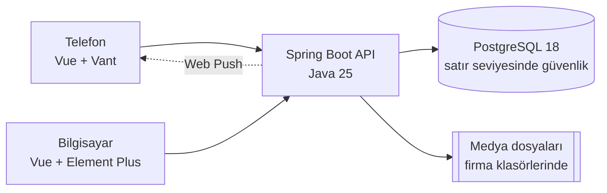

# 02 · Mimari

## Büyük resim



Tek bir arayüz uygulaması ve tek bir backend var. Arayüz açılırken ekranın telefon mu bilgisayar mı olduğuna bakıyor ve
iki kabuktan birini yüklüyor: telefonda Vant, bilgisayarda Element Plus. İş mantığı iki kabukta ortak (ayrıntısı
[05 · Arayüz](05-arayuz.md)'de).

## Dört yüzey

| Kim | Nerede | Ne yapar |
|---|---|---|
| Ziyaretçi | `/`, `/fiyatlar`, `/basvuru` | Ürünü tanır, paketleri karşılaştırır, başvurur |
| Satın alan firma | `/kurulum/:token` | Tek kullanımlık linkle firmasını kurar: bilgiler, logo, patron hesabı, ilk şantiye |
| Firmanın kişileri | `/santiyeler`, `/yoklama`, `/malzemeler`, `/firma` | Yalnızca kendi firmasının verisini görür; paketinin açtığı modülleri kullanır |
| Bizim ekibimiz | `/platform-admin` | Firmalar, abonelik ve ödemeler, kurulum linkleri, başvurular, paketler, işlem geçmişi |

## Teknoloji seçimleri ve nedenleri

| Katman | Seçim | Neden |
|---|---|---|
| Arayüz | Vue 3, TypeScript, Vite | Bileşen yapısı sade, TypeScript ile tipler backend'e kadar uzanıyor |
| Telefon | Vant | Dokunmaya göre yapılmış hazır bileşenler: alt sayfa, kaydırarak silme, takvim |
| Bilgisayar | Element Plus | Tablo, form, yan panel gibi yoğun yönetim ekranları |
| Sunucu verisi | TanStack Vue Query | Önbellek, yeniden deneme ve tazeleme tek bir yerde |
| API istemcisi | Orval | Backend'in OpenAPI dokümanından tipli fonksiyonlar üretiyor; elle yazılmış istek yok |
| Backend | Java 25, Spring Boot 4 | Güvenlik, doğrulama ve zamanlanmış işler hazır geliyor; tipli ve olgun bir ekosistem |
| Veritabanı | PostgreSQL 18 | Satır seviyesinde güvenlik (RLS), Türkçe sıralama (ICU), güçlü işlem (transaction) desteği |
| Şema | Flyway | Her değişiklik numaralı bir SQL dosyası; yayınlanmış bir migration bir daha düzenlenmez |
| Testler | JUnit + Testcontainers, Vitest, Playwright | Backend testleri gerçek PostgreSQL'de koşuyor; arayüz telefon ve masaüstü ekranında uçtan uca test ediliyor |
| Kurulum | Docker Compose | Tek komut: `./scripts/start.sh` |

Bağımlılıkları bilerek az tuttum. Kural basit: yeni bir kütüphane yalnızca ihtiyaç duyulduğu an eklenir. Örneğin
bildirim göndermek için hazır bir Web Push kütüphanesi kullanmadık; neden gerekmediğini [06 · Backend](06-backend.md)'de
anlattım.

## Neden tek bir uygulama (monolit)?

İki kişilik bir ekip, tek bir veritabanı ve tek bir iş alanı. Uygulamayı mikroservislere bölmek bize ağ gecikmesi,
dağıtık işlem ve ayrı dağıtım dertleri getirirdi; karşılığında bir şey kazandırmazdı.

Onun yerine monoliti içeriden böldüm. Backend'de her özelliğin kendi paketi var (`site/`, `puantaj/`, `material/` …).
Paketin içinde katman atlanmıyor: Controller yalnızca HTTP'yi karşılıyor, Service iş kuralını uyguluyor, Repository
veriye erişiyor. Bir gün bir modülü ayırmak gerekirse sınırları zaten belli.

## Bir isteğin yolculuğu

Telefondaki bir şefin şantiye listesini açtığını düşünelim:

```text
Tarayıcı: GET /api/sites  (çerez: ks_session)
  → Vercel ya da nginx: arayüz ve API aynı adreste, /api backend'e gider
  → ProxyGate: istek gerçekten vekilden mi geldi? (yalnızca Vercel arkasında)
  → Oturum: çerezdeki token geçerli mi, kişi kim?
  → Çalışma alanı: hangi firma, rolü ne, abonelik açık mı, paket hangi modülleri açıyor?
  → TenantContextFilter: veritabanı bağlantısına firmanın kimliği yazılır
  → Yetki: @PreAuthorize izni, @RequiresFeature modülü kontrol eder
  → SiteController → SiteService (firmaya göre süzer) → PostgreSQL (RLS bir kez daha süzer)
```

Firmanın aboneliği bitmişse istek `403 WORKSPACE_LOCKED` döner ve arayüz kilit ekranını gösterir. Veri silinmez;
abonelik yenilenince her şey kaldığı yerden devam eder.

## Klasörler

```text
atalay-santiye/
├── frontend/          Vue uygulaması
│   └── src/
│       ├── app/       açılış: kabuk seçimi, router, eklentiler
│       ├── core/      ortak beyin: API, oturum, iş mantığı (UI kütüphanesi yok)
│       ├── shared/    kütüphanesiz ortak bileşenler
│       ├── mobile/    yalnızca Vant: atoms → molecules → organisms → templates → pages
│       └── desktop/   yalnızca Element Plus: aynı beş katman
├── backend/           Spring Boot API, özellik bazlı paketler, Flyway migration'ları
├── docker/            nginx ve imaj ayarları
├── scripts/           start, stop, logs, reset
└── docs/              bu belgeler
```

## Sayılarla

| | |
|---|---|
| Backend | ~490 Java dosyası, 24 özellik paketi, 31 Flyway migration |
| Arayüz | ~330 Vue bileşeni, iki kabuk (telefon ve bilgisayar) |
| API | 120'den fazla uç; arayüzdeki istemci bunlardan otomatik üretiliyor |
| Roller | Patron, Şantiye şefi, Depo sorumlusu, Çalışan ve bunlardan ayrı Platform yöneticisi |
